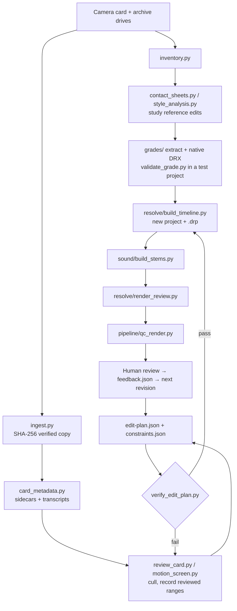

# Resolve Edit Pipeline

Python scripts and a written workflow for turning a card of event footage into an editable DaVinci Resolve Studio project, a graded review render and separate sound stems, with an AI agent doing the mechanical work and a human making the editorial calls.

## Why

Most "AI video editing" skips the parts that make an edit trustworthy: verified copies of the originals, shot ranges that were actually checked for camera movement, music rights, sound that stays in sync after picture changes, and a render someone has inspected. This pipeline makes each of those an explicit step with a script and a written rule, so an agent driving Resolve can't quietly claim more than it did.

## Features

- **Verified ingest.** Copies a card's folder structure and checks SHA-256 of source and copy; an existing copy that differs is an error.
- **Inventory and reference discovery.** Scans drives for video, audio and Resolve projects, and separates camera originals from finished edits worth studying.
- **Sony sidecar metadata.** Reads XAVC XML for frames, fps, camera, gamma and primaries; optional whisper.cpp transcripts, with a voice-EQ second pass.
- **Review sheets.** Card thumbnail pages, 3-point strips per clip, 8-frame sheets for reference edits, and 16-frame sheets with scene-change pacing.
- **Motion screening.** Phase correlation between frames at 12 fps flags resets and reframes inside planned ranges, with a dense frame sheet for a human to check.
- **Plan verification.** `verify_edit_plan.py` fails a plan that uses a rejected clip, misses a required person, reuses a shot too often, or goes outside a reviewed in/out range.
- **Resolve assembly.** Creates a new project (refuses to overwrite one), colors and marks selects, lays out the planned ranges, keeps chosen sync audio, and exports a `.drp` plus frame positions for later steps.
- **Sound stems.** Two-pass loudnorm dialogue and ambience from the camera's own audio, music ducked under speech with linear ramps, peak-normalized SFX placed just before cuts, a limited review mix, and a manifest of every source and gain.
- **Film Look Creator recovery.** Decodes grades from old `.drp` archives offline (Zstandard bodies), finds Film Look nodes, writes native DRX candidates, and can transplant one group's post-clip grade into a new project byte-for-byte.
- **Render and QC.** Renders an H.264 review copy, waits for Resolve to report completion, then samples every shot and runs blackdetect/volumedetect on the file.

## How it works



`WORKFLOW.md` is the eight-step process the scripts serve. `EDITING-PREFERENCES.md` holds durable editing rules and the learning loop that turns each round of client feedback into a check. Both are written to be loaded by an agent before it touches footage.

## Tech stack

- Python 3.11+ (3.14+ for `grades/extract_grades.py`, which uses `compression.zstd`)
- Pillow, NumPy
- FFmpeg / ffprobe
- whisper.cpp (optional, for transcripts)
- DaVinci Resolve Studio with external scripting enabled (`resolve/` scripts)
- Swift (one small AppKit helper to find and focus the Resolve window)

## Getting started

```bash
git clone https://github.com/ianroyes-sys/resolve-edit-pipeline
cd resolve-edit-pipeline
python3 -m venv .venv && source .venv/bin/activate
pip install -r requirements.txt
cp .env.example .env   # optional: point at ffmpeg, whisper.cpp, Resolve modules
set -a; source .env; set +a
```

A typical job (paths are yours):

```bash
JOB=jobs/spring-gala
python3 pipeline/inventory.py $JOB archive=/Volumes/Archive card=/Volumes/Card
python3 pipeline/ingest.py /Volumes/Card/PRIVATE $JOB/media/PRIVATE
CLIPS=$JOB/media/PRIVATE/M4ROOT/CLIP
python3 pipeline/card_metadata.py $CLIPS $JOB C0042            # metadata + one transcript
python3 pipeline/review_card.py $CLIPS $JOB/card-metadata.json $JOB/review
# write $JOB/edit-plan.json and $JOB/constraints.json (see examples/)
python3 pipeline/motion_screen.py $CLIPS $JOB/edit-plan.json $JOB/review/motion
python3 pipeline/verify_edit_plan.py $JOB/edit-plan.json $JOB/constraints.json
python3 resolve/build_timeline.py $JOB/edit-plan.json $JOB/card-metadata.json $CLIPS $JOB/exports
python3 sound/build_stems.py $JOB/sound-plan.json $JOB/exports/timeline-build.json $CLIPS $JOB/sound
python3 resolve/render_review.py "Spring Gala - Recap - v01" $JOB/exports Spring-Gala-Review-v01
python3 pipeline/qc_render.py $JOB/exports/Spring-Gala-Review-v01.mp4 $JOB/exports/timeline-build.json $JOB/review/render
```

Every script prints its usage when run without arguments. `jobs/` is git-ignored, so footage and client work stay out of the repo.

## Project structure

```
pipeline/            ffmpeg/Pillow tools, no Resolve needed
  inventory.py         drive scan, reference-edit candidates
  ingest.py            SHA-256 verified card copy
  card_metadata.py     Sony XML sidecars + whisper.cpp transcripts
  contact_sheets.py    card thumbnails, reference sheets
  review_card.py       3-point strip per clip
  motion_screen.py     phase-correlation camera-movement screen
  style_analysis.py    16-frame sheets + scene-change pacing
  verify_edit_plan.py  plan vs. feedback constraints
  qc_render.py         render sampling + decode/black/volume checks
resolve/             DaVinci Resolve scripting API
  build_timeline.py    new project from a plan
  render_review.py     H.264 review render + editable .drp
  validate_grade.py    try a DRX in a disposable project
  export_projects.py   back up projects as .drp
  swap_shots.py        in-place shot swap, same position and length
  inspect_resolve.py   version, projects, settings
  resolve_ui.swift     list/focus Resolve windows
sound/build_stems.py dialogue / natural / music / SFX stems + review mix
grades/              offline Film Look Creator recovery from .drp archives
examples/            edit plan, constraints, sound plan, swap map
WORKFLOW.md          the eight-step process and the motion gate
EDITING-PREFERENCES.md durable editing rules and the feedback loop
```

## Status

Used on real commissions in 2026: an event film delivered as an editable Resolve project with a review render, a sound-design pass on a short, and a shot swap on a sports recap. The scripts in this repo are generalized from those jobs (job names, footage paths and client material removed), so treat them as a working toolkit rather than a packaged product. Built for macOS and Sony XAVC cards; other cameras need a different sidecar reader.

Built by [Ian Royes](https://github.com/ianroyes-sys)
